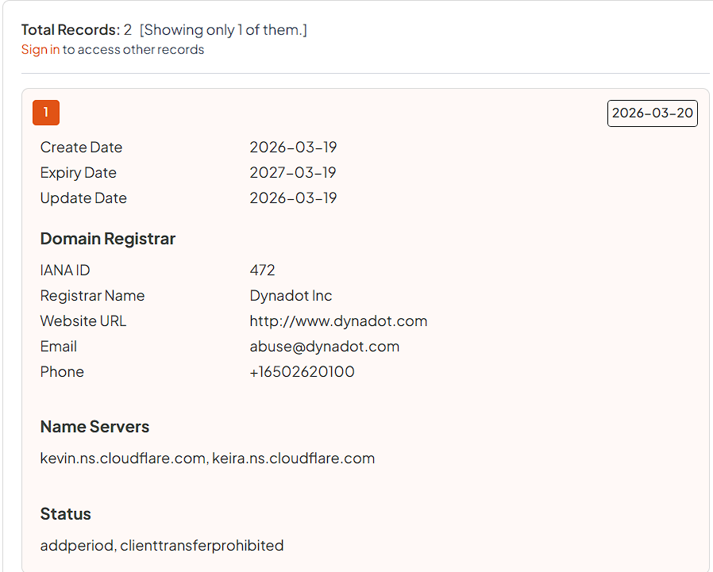

# Toll Booth Scams - Cracking A Scammer's Encryption

I received a text message from a toll violation scammer this week with the following image. It was pretty well crafted, but a highly obvious phishing attempt. On the poster, the judge's name is _John Smith_, but signed at the bottom as "Clerk of the Court" is also _John Smith_. I don't know about you, but John Smith is the most stereotypical American name I've ever heard of. So my first step was to examine the QR code at the bottom.

<figure><figcaption><p>Phishing Lure sent to me</p></figcaption></figure>

I scanned the QR code via an [online website](https://scanqr.org/), which revealed a URL: `hxxps[:]//oe.xykri.com/public/马里兰1`. I booted up an [any.run](https://app.any.run/tasks/72b87f0f-6073-428a-8373-b1ec22641adb) analysis and started digging in. At first, `xykri.com` appears as a legitimate verification website. (Or at least it tries to)

<figure><figcaption><p>oe.xykri.com landing page</p></figcaption></figure>

The URL is definitely fishy, but it doesn't seem horribly malicious. Before we click _verify_, let's look a little deeper.&#x20;

Examining xykri.com's HTML, we see the following after scrolling down past the body section (This HTML file can be found in the any.run analysis linked above):&#x20;


```javascript

    <!-- Hidden Chinese context for specific users -->
    <!-- 
      此页面为真人身份验证。
      当用户确认身份时，系统将验证合法性，如果通过则解密并跳转目标地址。
    -->

const code = "马里兰1";

async function verifyAction() {
  const btn = document.getElementById('verifyBtn');
  const card = document.getElementById('mainCard');

  if (btn.classList.contains('loading')) return;

  btn.classList.add('loading');

  try {
    // To create a realistic "verifying" feel
    await new Promise(r => setTimeout(r, 600));

    const response = await fetch(`/api/verify/${code}`, {
      method: 'POST'
    });

    if (response.ok) {
      const data = await response.json();
      if (data.url) {
        window.location.href = data.url;
        return;
      }
    }

    // If failed
    throw new Error("Verification failed");

  } catch (error) {
    btn.classList.remove('loading');
    btn.innerText = "Error - Try Again";
    btn.style.background = "#ef4444";

    card.classList.remove('shake-error');
    void card.offsetWidth; // trigger reflow
    card.classList.add('shake-error');

    setTimeout(() => {
      btn.innerText = "I'm a real person";
      btn.style.background = ""; // reset to CSS default
    }, 2000);
  }
}
```


This script tells us a few things:

* This website is of Chinese origin.
  * This text `此页面为真人身份验证。  当用户确认身份时，系统将验证合法性，如果通过则解密并跳转目标地址。`  translates to `This page requires human identity verification. Upon user confirmation of identity, the system will verify its legitimacy; if successful, it will decrypt the content and redirect to the target address.`&#x20;
* The script makes a `POST` request upon click to oe.xykri.com/api/verify/${code}
  * The "code" variable is defined on line 8: `const code = "马里兰1";`&#x20;
    * The Chinese in this variable translates to `Maryland1`.
  * The user is then redirected to the target website on line 29: `window.location.href = data.url;`

Knowing that this website serves as a redirect to send users to a secondary site, I proceeded with my analysis.&#x20;

Clicking verify, I got sent to a new domain: `hxxps[:]//ilsos.orekx.life/pay`. Looking at the site was a little odd, considering that the poster was for an alleged violation in "Baltimore." This site was actually impersonating the Illinois Secretary of State website.

<figure><figcaption><p>ilsos.orekx.life main page</p></figcaption></figure>

The site was well put together, but the first thing I noticed was that none of the other buttons worked besides the "Continue" button, which allowed you to pay the fine. Importantly, this site was practically a clone of the real one, adding to its perceived legitimacy.

<figure><figcaption><p>Legitimate ilsos.gov page</p></figcaption></figure>

The second thing was that any.run alerted me that this website had logged my IP info. Typically, most websites have access to your IP address, but doing an external lookup is generally very suspicious. I may have made the mistake of running the website without a VPN.

<figure><figcaption><p>Screenshot of any.run analysis Network Threats section</p></figcaption></figure>

Before I clicked on the "Continue" button, I wanted to see if I could find out anything else about the website. I ran a second [any.run](https://app.any.run/tasks/cb8aa154-c6c5-4d32-a72e-cb1bfe443f39) analysis and tried out a few subdirectories. This revealed that the index.html page was actually the default one, and that the website was running OpenResty, a combination of Nginx and Lua libraries.&#x20;

<figure><figcaption><p>ilsos.orekx.life default page</p></figcaption></figure>

Adding a random subdirectory revealed the exact version: 1.29.2.1. This wasn't really helpful, but it was good information to have.

<figure><figcaption><p>ilsos.orekx.life/test page</p></figcaption></figure>

I started another [safebrowsing any.run analysis](https://app.any.run/browses/5bf640ae-d7ef-43e3-b36f-7bb07ca35b2b) and tested what would happen if I filled out the forms. I was redirected to `/pay/b_info.html` where I was asked to input billing information. After inputting my "information", I was directed to `/pay/c_info.html` where I was asked for my credit card info. Not a good sign.&#x20;

<figure><figcaption><p>ilsos.orekx.life credit card form</p></figcaption></figure>

I was prompted with Microsoft Wallet options, adding to the perceived legitimacy. While I did not have any credit card information in Microsoft Edge, as this was a sandboxed environment, individuals with credit card information saved could easily be tricked by this. I decided to generate some fake credit card numbers using [PayPal](https://developer.paypal.com/test-card-manager/)'s credit card generator to see what would happen. After entering the data, I was stuck waiting for the credit card to verify.

<figure><figcaption></figcaption></figure>

This was a pretty typical, realistic-looking (ish), phishing scam. Nothing super surprising. Okay, so what next?

My next step was to look at the network traffic. The website makes its usual requests for images, JavaScript, and site HTML, but the first request that piqued my interest was a POST request to `/pay/api/open/getSyncSettings`. Opening the request reveals gibberish request and response data. All following requests to the `/pay/api` endpoints contained similarly garbled data. From that, I reasonably assumed this was encrypted. &#x20;

<figure><figcaption><p>Request data for /pay/api/open/getSyncSettings</p></figcaption></figure>

The other item of note was that the website was making consistent requests to a `pollInstruction` endpoint. I wasn't sure what this was at that time, but I believed it was pinging a Command and Control (C2) server for some sort of instructions. More on this later.&#x20;

<figure><figcaption></figcaption></figure>

So here's what we knew so far: We had a somewhat sophisticated Chinese phishing scam that spanned at minimum two domains with the intent to extract credit card and billing information from individuals. Network traffic was encrypted (my guess: to bypass detection), and the website was in communication with a C2 server. Now, I just need to confirm these assumptions with evidence.

Before further analysis, I went back to the reconnaissance phase. I conducted a few [WHOIS](https://lookup.icann.org/en) lookups on the website using ICANN and discovered that the website was under the registrar **Dynadot**. (I am using a historical WHOIS lookup site because I made the fatal mistake of not taking screenshots at the time.)

<figure><figcaption><p>Historical WHOIS lookup for orekx.life on <a href="https://whoisfreaks.com/tools/whois/history/lookup">whoisfreaks</a></p></figcaption></figure>

I then ran a WHOIS lookup on the original domain, `oe.xykri.com`, and it came back to a Chinese registrar named **Cloud Yuqu LLC** hosted at the website `diymysite.com`. Some googling also reveals that this registrar is commonly associated with phishing schemes, so a bad sign all around. &#x20;

<figure><figcaption><p>WHOIS Lookup on <a href="https://www.whoxy.com/xykri.com#raw">whoxy</a></p></figcaption></figure>

I filled out the Dynadot abuse webform (after a quick email exchange) for `orekx.life`, and it was taken down within 48 hours. I also filed a report for `xykri.com`, but unfortunately, I received no response from the registrar. Luckily, ICANN has [requirements](https://www.icann.org/resources/pages/abuse-2014-01-29-en) for registrars to follow, which include:

* Maintaining an abuse reporting phone number and email that is monitored 24/7.
* Investigating and appropriately responding to reports within 24 hours

If registrars fail to meet these guidelines, they can be reported to ICANN and risk losing their accreditation. You lose your accreditation, you can't sell and manage domains, and you most definitely cannot make money. Because I had not received a response from Cloud Yuqu LLC within 24 hours, and the domain was still up at the time, I filed an official ICANN abuse report. I am still waiting to hear back.&#x20;

When I checked back on `ilsos.orekx.life`, the site had been taken down, but instead, xykri.com was now redirecting me to a different domain, hosting the same backend website: `ilsos.hxlkm.life`. Same registrar (Dynadot), different domain. It was clear that these scammers were using Cloud Yuqu LLC to shield themselves from abuse reports, using `xykri.com` to redirect victims to another domain as soon as the secondary one goes down. I'm still not sure why they didn't host their original phishing site with Cloud Yuqu, so if anyone knows, feel free to message me!

Let's get back to some site analysis. Remember how I said all that network traffic was encrypted? Well, I wanted to figure out how to crack it. Knowing that both the client and the server were sending encrypted data (and assuming symmetric encryption), there had to be a decryption key somewhere in the source code.&#x20;

I started looking at some of the JavaScript files using Chrome Developer Tools, and I found something very promising. There were a few scripts, but there was exactly one obfuscated script: `main.js`. It contained mentions of encrypt, decrypt, and AES-CTR, which is a type of encryption cipher. People (in general) typically only obfuscate scripts that they don't want people to see, so this must be it.

<figure><figcaption><p>Screenshot of main.js for ilsos.orekx.life via <a href="https://any.runhttps/app.any.run/browses/a72e2bc9-c99d-43f8-958d-1b1c15d9e1f6">any.run</a> network inspector</p></figcaption></figure>

I exported the script, saved it locally, and started looking through it. General note: Obfuscated code kinda sucks. It is intentionally made hard to read. Luckily, our new AI pals excel at parsing and understanding obfuscated code. I booted up Claude Opus 4.6, fed it the script, and sat back while Claude worked its magic. After deobfuscating and beautifying the script (and nearly crashing my computer as it opened the massive JavaScript file by default in my browser), it had done it! As a side note, there are also other online JavaScript deobfuscators.&#x20;

<figure><figcaption><p>Response from Claude</p></figcaption></figure>

While it is important to take all AI output with a grain of salt, the results were undeniable. It had identified that the key and IV were stored in the network request itself and was able to decrypt data. Proving this, I fed it an encrypted request with the credit card data we entered before (that it hadn't seen before), and it spat out perfect JSON. &#x20;


```json
{
  "id": "JWRCVV-1773954775746-bfuqjf2k1x-9vb5qcquoji",
  "firstname": "Champ",
  "lastname": "Beaver",
  "fullname": "",
  "country": "US",
  "state": "CA",
  "city": "Los Angeles",
  "postcode": "54012",
  "address1": "100 House Ave",
  "address2": "",
  "phoneNumber": "3056322334",
  "email": "champbeaver@gmail.com",
  "email_pwd": "",
  "two_factor_authentication": "",
  "gender": "",
  "ssn": "",
  "dob": "",
  "passport_number": "",
  "license_number": "",
  "medical_number": "",
  "ssn_img": "",
  "ssn_handheld_img": "",
  "passport_img": "",
  "passport_handheld_img": "",
  "license_img": "",
  "license_handheld_img": "",
  "medical_img": "",
  "medical_handheld_img": "",
  "cvv_fullName": "James Doe",
  "cvv_cardnumber": "4868 7191 9682 9038",
  "cvv_expiry": "04/29",
  "cvv_cvv": "344",
  "cvv_frontImg": "",
  "cvv_backImg": "",
  "cvv_handheld_img": "",
  "cvv_brand": "VISA",
  "cvv_type": "CREDIT",
  "cvv_category": "BUSINESS",
  "cvv_issuer": "AMERICA FIRST FEDERAL CREDIT UNION",
  "cvv_country": "UNITED STATES",
  "cvv_pin": "",
  "ip": "127.0.0.1",
  "device": "电脑 - Windows - Edge",
  "language": "en-US",
  "timeZone": "UTC",
  "userAgent": "Mozilla/5.0 (Windows NT 10.0; Win64; x64) AppleWebKit/537.36 (KHTML, like Gecko) Chrome/133.0.0.0 Safari/537.36 Edg/133.0.0.0",
  "cookie": "",
  "source": "https://ilsos.orekx.life/pay",
  "extraJSON": "",
  "web_login_account1": "",
  "web_login_pwd1": "",
  "web_login_type1": "",
  "web_login_account2": "",
  "web_login_pwd2": "",
  "web_login_type2": "",
  "web_login_account3": "",
  "web_login_pwd3": "",
  "web_login_type3": "",
  "paypal_login_account": "",
  "paypal_login_pwd": "",
  "operator_by": "",
  "update_time": "",
  "state1": "",
  "state2": "",
  "state3": "",
  "operational_status": "提交卡信息,需操作!",
  "current_page": "c_pay.html",
  "online_status": "1",
  "custom_phone": "",
  "custom_email": "",
  "custom_news": "",
  "operation_code": "1",
  "release_code": "card_submit",
  "latitude": "28.5383",
  "longitude": "-81.3792",
  "card_submission_type": "同步卡提交",
  "belong_to_template": "US-IL-ticket-ilsos",
  "custom_form_data": "{\"id\":\"JWRCVV-1773954775746-bfuqjf2k1x-9vb5qcquoji\",\"firstname\":\"Champ\",\"lastname\":\"Beaver\",\"country\":\"US\",\"state\":\"CA\",\"city\":\"Los Angeles\",\"postcode\":\"54012\",\"address1\":\"100 House Ave\",\"phoneNumber\":\"3056322334\",\"email\":\"champbeaver@gmail.com\",\"cvv_fullName\":\"Champ Beaver\",\"ip\":\"127.0.0.1\",\"device\":\"电脑 - Windows - Edge\",\"language\":\"en-US\",\"timeZone\":\"UTC\",\"userAgent\":\"Mozilla/5.0 (Windows NT 10.0; Win64; x64) AppleWebKit/537.36 (KHTML, like Gecko) Chrome/133.0.0.0 Safari/537.36 Edg/133.0.0.0\",\"source\":\"https://ilsos.orekx.life/pay\",\"current_page\":\"b_info.html\",\"latitude\":\"28.5383\",\"longitude\":\"-81.3792\",\"belong_to_template\":\"US-IL-ticket-ilsos\",\"redirect_mode\":\"0\",\"currency_symbol\":\"$\"}",
  "success_url": "",
  "fail_url": "",
  "redirect_mode": "0",
  "notify_url": "",
  "currency_symbol": "$",
  "order_amount": 0,
  "client_timestamp": 1773955037357
}
```


If you have access to a similar website conducted by the same scammers, you might be able to use this script to decrypt the packets. At the time of writing this, `ilsos.hxlkm.life` is still up, so you should be able to use this script to decrypt request and response data.&#x20;


```python
#!/usr/bin/env python3
"""
JWR Phishing Kit Decryptor
Decrypts AES-256-CTR encrypted request/response bodies used by the
JWR credit card phishing panel.

Protocol:
  - Bytes [0:32]  = AES-256 key
  - Bytes [32:48] = CTR counter/IV (16 bytes)
  - Bytes [48:]   = AES-256-CTR ciphertext
  - Plaintext is JSON (UTF-8)

Usage:
  python jwr_decrypt.py <file>              Decrypt a single binary file
  python jwr_decrypt.py <file1> <file2> ... Decrypt multiple files
  python jwr_decrypt.py --dir <folder>      Decrypt all files in a directory
  python jwr_decrypt.py --hex <hex_string>  Decrypt a hex-encoded payload
"""

import sys
import os
import json
from cryptography.hazmat.primitives.ciphers import Cipher, algorithms, modes

def decrypt_jwr(data: bytes) -> dict | str:
    """
    Decrypt a JWR AES-256-CTR payload.
    
    Args:
        data: Raw binary payload (key + IV + ciphertext)
        
    Returns:
        Parsed JSON object, or raw string if not valid JSON
    """
    if len(data) < 49:
        raise ValueError(f"Payload too short ({len(data)} bytes). "
                         f"Need at least 49 (32 key + 16 IV + 1 ciphertext).")

    key = data[0:32]
    iv = data[32:48]
    ciphertext = data[48:]

    cipher = Cipher(algorithms.AES(key), modes.CTR(iv))
    decryptor = cipher.decryptor()
    plaintext = decryptor.update(ciphertext) + decryptor.finalize()

    text = plaintext.decode("utf-8")

    try:
        return json.loads(text)
    except json.JSONDecodeError:
        return text


def decrypt_file(filepath: str) -> dict | str:
    """Read a binary file and decrypt it."""
    with open(filepath, "rb") as f:
        data = f.read()
    return decrypt_jwr(data)


def decrypt_hex(hex_string: str) -> dict | str:
    """Decrypt a hex-encoded payload."""
    data = bytes.fromhex(hex_string.strip())
    return decrypt_jwr(data)


def print_result(label: str, result):
    """Pretty-print a decryption result."""
    print(f"\n{'=' * 60}")
    print(f"  {label}")
    print(f"{'=' * 60}")
    if isinstance(result, dict):
        print(json.dumps(result, indent=2, ensure_ascii=False))
    else:
        print(result)
    print()


def main():
    if len(sys.argv) < 2:
        print(__doc__)
        sys.exit(1)

    if sys.argv[1] == "--hex":
        if len(sys.argv) < 3:
            print("Error: --hex requires a hex string argument")
            sys.exit(1)
        result = decrypt_hex(sys.argv[2])
        print_result("Hex payload", result)

    elif sys.argv[1] == "--dir":
        if len(sys.argv) < 3:
            print("Error: --dir requires a directory path")
            sys.exit(1)
        directory = sys.argv[2]
        for filename in sorted(os.listdir(directory)):
            filepath = os.path.join(directory, filename)
            if os.path.isfile(filepath):
                try:
                    result = decrypt_file(filepath)
                    print_result(filename, result)
                except Exception as e:
                    print(f"\n[!] {filename}: {e}")

    else:
        for filepath in sys.argv[1:]:
            try:
                result = decrypt_file(filepath)
                print_result(os.path.basename(filepath), result)
            except Exception as e:
                print(f"\n[!] {filepath}: {e}")


if __name__ == "__main__":
    main()
```


It had also solved our riddle about the website's constant requests to the `pollInstruction` endpoint. The website was communicating with a backend operator about my information. More importantly, examining the deobfuscated JavaScript (and decrypted JSON) revealed something interesting. It made mentions to data like SSNs, passport numbers, and medical ID information that we weren't prompted for on the website. This leads me to believe that this script is not just being used for credit card scams, but also for other, more complex phishing schemes. As such, this script is likely part of a phishing toolkit.

While writing this, several LinkedIn posts popped up mentioning other, similar phishing campaigns, which led me to an in-depth [report from Crimson Vector](https://crimsonvector.com/research/lighthouse-smishing-syndicate-2026/) describing a phishing scheme using .life TLDs. While it doesn't cover the internals of the target sites, it clearly identifies phishing indicators and TLDs like .life and .bond (which I saw in a similar text message, but was taken down by the time I attempted to analyze it).

My analysis ended there, and when I revisited these domains a week later, `xykri.com` and `orekx.life` were taken down, likely rotated to other domains. As of writing this, `ilsos.hxlkm.life` is still **online**.&#x20;

**So what did we learn?** This is a pretty sophisticated Chinese SMS phishing scam targeting individuals using the threat of a toll violation. The operators use an initial landing site hosted with an unresponsive Chinese registrar to redirect victims to a secondary site designed to extract credit card and billing data. That secondary site communicates with a backend operator through persistent polling, updating them on the victim's status and submitted information in real time. The network traffic itself is encrypted with AES-256-CTR, likely to avoid detection, but the implementation is fundamentally broken. The key and IV are stored in the first 48 bytes of every request, making decryption trivial once you know where to look. Identifying the obfuscated `main.js` as the target and using Claude to deobfuscate it was what cracked this open. Perhaps the most interesting finding was what the decrypted data revealed beyond credit cards: fields for SSNs, passport numbers, and medical IDs that were never prompted for on this particular site. That, combined with the Crimson Vector report describing the common use of Phishing as a Service (PhaaS), strongly suggests this isn't a one-off scam but a configurable toolkit being deployed across multiple campaigns.

Listed below for your convenience are Indicators of Compromise and the recovered JavaScript files.


This was my first time looking into phishing websites and doing a full technical breakdown, so I hope you appreciated the read! My analysis could have gone deeper, but I definitely learned a lot through this process. Please feel free to message me on LinkedIn if you have any feedback or questions!


## Indicators of Compromise (IOCs)

### URLs

| Indicator                            | Type | Notes                         |
| ------------------------------------ | ---- | ----------------------------- |
| `hxxps[:]//oe.xykri.com/public/马里兰1` | URL  | Initial lure URL from QR code |
| `hxxps[:]//ilsos.orekx.life/pay`     | URL  | Phishing payment page         |
| `hxxps[:]//ilsos.hxlkm.life/`        | URL  | Phishing payment page         |

### API Endpoints

| Indicator                       | Type     | Notes                              |
| ------------------------------- | -------- | ---------------------------------- |
| `/api/verify/{code}`            | Endpoint | Redirect verification (POST)       |
| `/pay/api/open/getSyncSettings` | Endpoint | Encrypted data exfiltration (POST) |
| `/pay/api/open/pollInstruction` | Endpoint | Backend operator polling           |
| `/pay/b_info.html`              | Path     | Billing info collection form       |
| `/pay/c_info.html`              | Path     | Credit card collection form        |

### Patterns

| Indicator                         | Type       | Notes                                                         |
| --------------------------------- | ---------- | ------------------------------------------------------------- |
| `.life` / `.bond`                 | TLDs       | Commonly used TLDs for secondary phishing domains             |
| AES-256-CTR (key\|IV\|ciphertext) | Encryption | Key in bytes 0–31, IV in bytes 32–47, ciphertext from byte 48 |

## JavaScript Source Files

[Google Drive Link to main.js](https://drive.google.com/file/d/1A1GOmXHUnQNg_4BqdendtGOXOLGDxehQ/view?usp=sharing)

[Google Drive Link to main\_deobfuscated.js](https://drive.google.com/file/d/1gCnx5pmGkUHjfj4vgrFEdg8LFIBrjqn2/view?usp=sharing)

