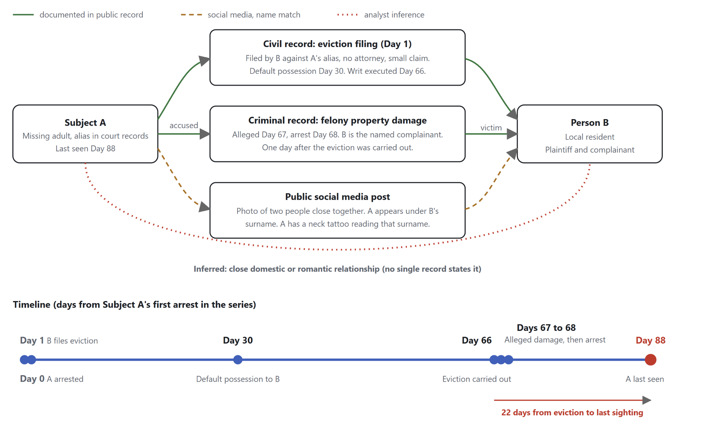

# Trace Labs MVO Writeup - Oct 24. 2026

We are two team members of Packet and Podium, the team that won the MVO for TraceLabs’ Search Party CTF 2026.10.24, and below is our write-up on the piece of intel we submitted that resulted in our team being awarded MVO. We hope you enjoy and learn something new.

_Anything you see in smaller-size font is mildly off-topic comments or other random thoughts we felt were important to add to this write-up. Feel free to skip past them._

### // Introduction

**Shabadoo:** Ben and I are 2nd-years at Champlain College, both studying Cybersecurity. We have no previous training or education in OSINT besides our individual experiences with TraceLabs and using OSINT on personal projects and research. If you’re curious for more, feel free to check out our LinkedIn and use your OSINT skills. (Ben: Use the OSINT in good health, of course.)

**Ben:** This was my and Shabadoo’s second time participating in TraceLabs. We first competed in June 2026 with one other team member from Tennessee Tech and placed Top 25, and we were really excited for the next competition. This time, we got to compete alongside three other teams from our school. (We also had five pies of Costco pizza, Halloween-themed cupcakes, Banana Bread, and Gatorade, so we were kind of set. Thank you, Chip!) Our two other teammates, Wetzel7 and Rynialate, focused on other MP’s and, as such, are not featured in this write-up. (I still love you guys, don’t worry.)

### // Initial OSINT

**Ben:** We had a solid understanding of how the CTF went, but last time, we relied a lot on googling and not a lot on automation. This time, we wanted to see how much we could push AI to discover new leads for us that we could run down ourselves. Despite this, I ended up being more hands-on, but Claude helped with our diagram and submission.

**Shabadoo:** Since our first time doing Trace Labs, I knew the ropes better and wanted to bring in more automation into the OSINT process. I began by setting up Claude with the find-skills skill, which pulls in skills to accelerate connections to open-source data brokers to identify as much information as possible on the target, saving links and dates. (I wish I had more Claude usage, too busy creating scam hunting stuff, rah.) As a secondary focus, I saved every single image identified as the target on the web to create a comprehensive timeline of events and images to identify gaps. (Ben: I was confused when Shabadoo first said “find-skills” skill out loud. I hope it wasn’t just me)

**Ben:** We had a lot of general success with social media, which usually contains a treasure trove of information. For this MP, we found many, many accounts, which gave us lots to work off of. (Shabadoo: so glad I made a burner FB account lol) (Ben: And thank god you did! We would have like five submissions if you didn’t..) I found one flag by using [https://whatsmyname.me/](https://whatsmyname.me/) and finding a new account on PicsArt, which identified a different hairstyle used by the MP that had been previously unreported. While we used a few different tools, both of us were running vanilla Windows, and we did a lot of googling. There was no crazy setup, no TL VM, just a laptop and an extra monitor. For this CTF, I also found that reverse image searches were entirely unhelpful...

As we got further along into the CTF and started exhausting information that we could find on social media, we pivoted to Criminal and Civil court records. Since the MP had multiple aliases (like 7…), we thought about going through every one of them, but Shabadoo found a mug shot and booking record from [Recentlybooked.com](http://recentlybooked.com/) that identified the legal name of the MP. This meant that this name would likely be used in all other court filings.

**Shabadoo:** After discovering the legal name from my large repository of images and links, I used my Claude skillset to connect to the local municipality's and state court records and pull the relevant details from each of them: defendant, crime, outcome, etc. The non-automated way of doing this was such a pain that automating it with AI saved us so much time. After putting this into a timeline, we uncovered details of the target's life before their disappearance.

**Ben:** There were roughly 10+ court records, and the website refused to filter by date, so we had to put it together manually. One team member alerted us to the possibility that the MP had received a speeding ticket a few days after the disappearance, though that turned out to be a false flag. They had a different middle name and ethnicity (shucks), so we moved on.

### // Analyzing The Court Cases

**Shabadoo:** Chronologically, we first uncovered a civil suit with the MP as a defendant, where the potential SO filed an Unlawful Detainer (an eviction order) against the MP. What is unusual is that the dollar amount behind the action (<$500) is extremely low for a standard landlord-tenant relationship. Usually, in these cases, they are set to the amount of missed rent, and sub-$500 is very low for rent in that area. This led to our conclusion that this was likely a civil matter between two cohabiting adults.

**Ben:** At the time, I made a comment to Shabadoo that I wish we had access to LInX, which is the Law Enforcement database that pools reports from all participating law enforcement agencies. Unfortunately, we’re stuck with what we can find in public databases.

<figure><figcaption>
Screenshot of the Redacted Felony Property Charge Record
</figcaption></figure>

**Shabadoo:** The next court case we looked at was for Felony Property Damage, a crime that was committed by the MP very soon after the eviction writ was written and shortly before their disappearance. This is a common sequence when a personal relationship breaks down; lashing out at the SO after they’re kicked out, indicating heightened emotions at the time of disappearance.

**Ben:** Further, the complainant in the court records had the same last name as some aliases used by the MP, which was a huge signal for us. We knew that the MP was in a relationship due to some of their Facebook pages indicating a relationship and some posts containing the two of them. Due to the nature of the record, being an eviction request, we knew that the MP lived with the complainant. Combining all of this evidence, we reasonably assumed the complainant was the MP’s SO.

**Shabadoo:** We submitted our flag under Romantic Partners, but our submission got bumped to Advanced Subject Info.

### // The Submission

Below is an anonymized version of the diagram we submitted for our submission, which clearly shows the events.

**We also included the following text with our submission (modified for grammar and anonymity):**

> Public court records from the \[X] Court suggest that MP (\[DOB], AKA “MP Alias”) had a close domestic relationship with SO of \[LOCATION] in the months before they disappeared. On \[DATE], one day after MP was arrested in \[LOCATION], arrest date \[DATE], SO filed an unlawful detainer action against “MP,” the alias the court officially records for MP (\[CASE-NUMBER]). The claim was small, <$500 plus \[$X] in costs, and SO filed without an attorney. That profile fits the removal of a household occupant better than a commercial landlord-tenant dispute. SO won possession by default on \[DATE], and the writ of eviction was executed on \[DATE]. The next day, \[DATE], MP allegedly damaged property belonging to SO, a Class 6 felony in which SO is the named complainant (\[CASE-NUMBER], arrested \[DATE]). That sequence of arrest, eviction filing, removal, and retaliatory property damage is consistent with a deteriorating personal relationship rather than an arm's-length tenancy. Social media appears to support the link. In a Facebook group post, the subject appears under the names “MP Alias A” and “MP Alias B.” The Facebook post also names “SO,” which we can presume to be MP’s partner. The image shows the two of them, heads together holding each other, showing a more than professional relationship. Taking a partner’s surname is also a common marker of a romantic relationship.

_Footnote: After our submission, we also identified the SO’s Facebook page and confirmed they had custody of the MP’s children, further reinforcing our assumption about their relationship._

### // Final Remarks

**Shabadoo:** Most of our flags came from the MP we won the MVO from. Having a better understanding of the MP enabled us to create deeper insights into their disappearance. Also, the other individuals either had almost no leads, were missing for a much longer time period, or had too much intel, like the bonus case we received.

As this CTF is so short in the grand scheme of MP investigations, only four hours, I felt like the greater combined focus on a single target enabled us to make better connections and create more well-rounded submissions. For our second time doing this, I am really proud of BeaverBusters as a whole and am excited to work on greater tooling for the next one. A special shout-out to BeaverBustersV2.0, who competed two feet away from us and got 2nd place :)

**Ben:** TraceLabs really is a unique opportunity that I don’t think Shabadoo or I have found anywhere else, and we’re really proud to be a part of this initiative. Sometimes I think we’re doing cyberstalking that really isn’t going to help anyone, but I have to remind myself that any information we find could genuinely help find these people.

Me and Shabadoo are honored to have received MVO, and we take pride in the work that we do. So an extra special thank you to TraceLabs when I say we literally could not have done it without you.



<mark style="color:$success;">Shabadoo</mark>\
**Milo von Klis**

[https://www.linkedin.com/in/m-vonklis/](https://www.linkedin.com/in/m-vonklis/)



<mark style="color:violet;">Benpinpop</mark>\
**Ben Polonsky**

[https://www.linkedin.com/in/ben-polonsky/](https://www.linkedin.com/in/ben-polonsky/)


